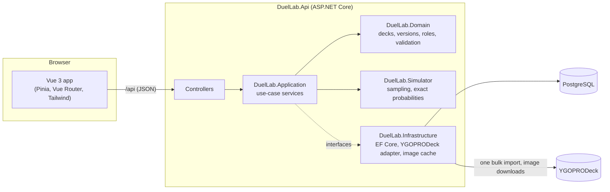
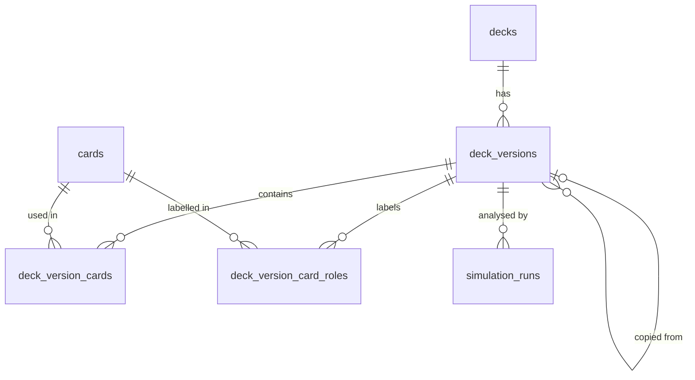

# Architecture

DuelLab is a **modular monolith**: one ASP.NET Core process that serves the REST API and the built
Vue app, backed by PostgreSQL. See [ADR 0001](adr/0001-modular-monolith-on-dotnet-10.md).

## Projects and dependencies

| Project | Responsibility | Depends on |
| --- | --- | --- |
| `DuelLab.Domain` | Cards, decks, versions, roles, simulation-run records, deck validation. No frameworks. | – |
| `DuelLab.Simulator` | Hand drawing, xoshiro256** generator, scenario evaluation, exact probabilities, statistics. No frameworks, no I/O. | – |
| `DuelLab.Application` | Use cases (`DeckService`, `CardCatalogService`, `SimulationService`), DTOs, repository and provider interfaces. | Domain, Simulator |
| `DuelLab.Infrastructure` | EF Core + PostgreSQL, repositories, YGOPRODeck adapter, file provider, image store, startup import. | Application, Domain |
| `DuelLab.Api` | HTTP: controllers, problem responses, composition root, static web app hosting. | Application, Infrastructure |
| `frontend/duellab-web` | The web UI. | the API over HTTP |

The Simulator and Domain have no dependency on each other: the Application layer translates a deck
version into the Simulator's generic `AnalysisCard` list. The provider's response format never leaves
Infrastructure (`YgoProDeckMapper` turns it into `CardData`).

## A simulation request

1. `POST /api/versions/{id}/simulate` reaches `VersionsController`.
2. `SimulationService` loads the deck version, validates it (`DeckValidator`), and normalises the
   configuration: default scenarios, a recorded seed, canonical role keys.
3. It builds a **snapshot** of the Main Deck (cards, quantities, roles) and calls
   `SimulationEngine.Run`, which computes exact probabilities and runs the seeded Monte Carlo loop.
4. The run is stored with its configuration, snapshot, results and engine version
   ([ADR 0006](adr/0006-versions-snapshots-and-reproducible-runs.md)).
5. The API returns the full run. Errors are RFC 9457 problem documents with a stable `code`.

## Data model

- `deck_version_cards` is keyed by (version, card, zone) and checks quantity 1–3.
- `deck_version_card_roles` is keyed by (version, card, role, custom name); built-in roles use an
  empty custom name, so the key is always unique.
- Enums are stored as text. Configuration is `jsonb`; results are stored as plain text exactly as
  the engine produced them.

## Frontend

- `src/api`: typed client mirroring the API contracts; `ApiError` carries the problem `code`.
- `src/lib/deckDraft.ts`: pure editing logic (copy limit, zones, roles), unit-tested.
- `src/stores/deckEditor.ts`: drafts per version, kept across navigation and reloads
  (sessionStorage) until saved or discarded; a banner links back to unsaved drafts.
- `src/components`: charts follow one visual system (single hue, thin marks, ink-coloured text,
  tooltips on hover and focus, a table for every chart) in light and dark mode.
